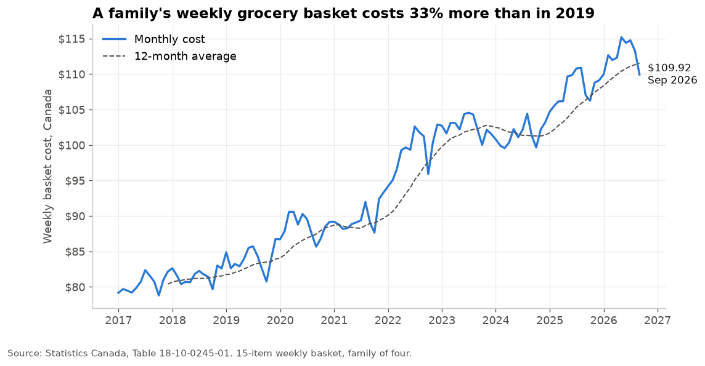
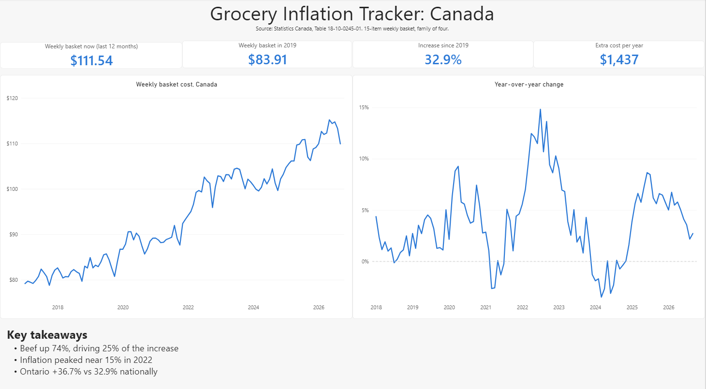
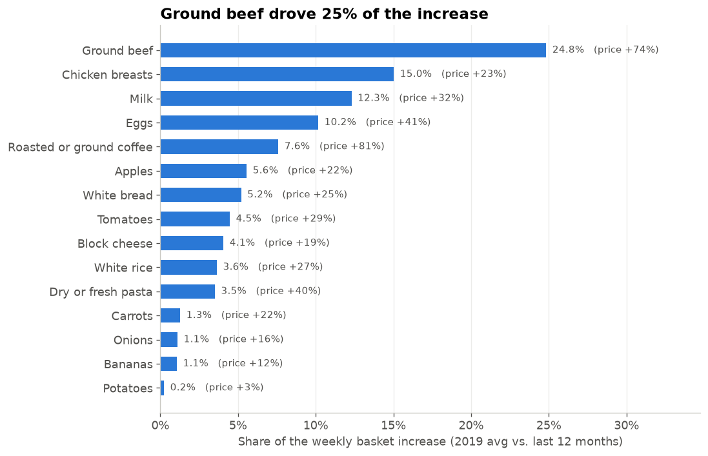
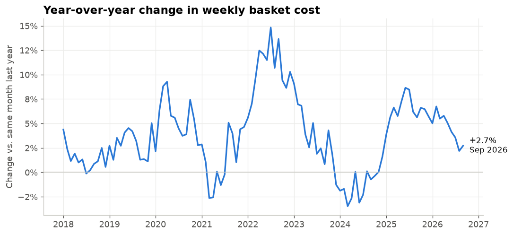
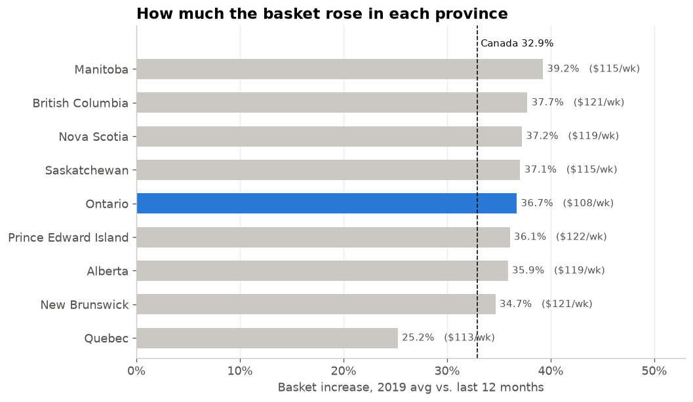

# Grocery Inflation Tracker

How much more does a Canadian family's grocery basket cost than in 2019, and which foods drove the increase?

## Power BI dashboard
Three pages: Overview, What drove the increase, and Provinces. File: `dashboard/grocery_tracker.pbix`

## Key findings
- **The basket rose 32.9% since 2019.** A family of four's average weekly staples cost went from **$83.91 in 2019** to **$111.54 over the last 12 months (Oct 2025 to Sep 2026)**, about **$1,437 more per year** for the same groceries.
- **Ground beef was the biggest driver.** Its average price rose 74% ($9.22 → $16.08/kg) and it accounts for **25% of the total increase**, consistent with the beef price surge noted in Canada's Food Price Report 2026.
- **Protein and dairy drove about two-thirds of the increase.** Beef, chicken, milk, eggs and cheese account for 66% of the extra weekly cost.
- **Every item got more expensive**, from +2.8% (potatoes) to +80.8% (coffee). Coffee rose the most but contributed only 8% of the increase, because families buy smaller quantities.

| Item | Avg 2019 | Avg last 12 months | Change | Share of increase |
|---|---|---|---|---|
| Ground beef, per kg | $9.22 | $16.08 | +74.4% | 24.8% |
| Chicken breasts, per kg | $11.81 | $14.58 | +23.4% | 15.0% |
| Milk, 4 L | $5.23 | $6.93 | +32.5% | 12.3% |
| Eggs, 1 dozen | $3.40 | $4.80 | +41.3% | 10.2% |
| Coffee, 340 g | $5.20 | $9.39 | +80.8% | 7.6% |

- **Grocery inflation came in waves.** Year-over-year increases peaked near 15% in 2022, briefly turned negative in early 2024, rose again to about 9% in 2025, and eased to 2.7% by September 2026, below Dalhousie's 4–6% forecast for food overall.
- **The recent slowdown isn't statistically confirmed.** Average monthly increases fell from 0.38% (2022–23) to 0.24% (last 12 months), but the difference is not significant (Welch t-test p = 0.42, Mann-Whitney p = 0.40). Recent increases are smaller, but not yet consistently enough to call it a confirmed slowdown.

- **Ontario rose faster than the national average.** Ontario's basket increased 36.7% vs. 32.9% nationally, though it remains the cheapest basket in the country at about $108/week. Manitoba rose the most (+39.2%) and Quebec the least (+25.2%). Quebec's smaller increase pulls the national figure below most provinces.

## Data
- Statistics Canada, *Monthly average retail prices for selected products* (Table 18-10-0245-01), pulled via the StatCan Web Data Service API
- Coverage: January 2017 to September 2026, national and provincial averages

## Method
**Basket:** 15 weekly staples for a family of four, covering all Canada's Food Guide groups (vegetables and fruit, protein foods, grains, dairy). Items were limited to products with a complete monthly price history since January 2019. Quantities are estimates and are listed in `data/basket.csv`. The approach is modelled on Ontario's Nutritious Food Basket, the method public health units use to cost a healthy diet for a reference family of four (Public Health Ontario, 2025).

**Comparisons:** all period comparisons use 12-month averages (2019 vs. the latest 12 months) to remove seasonal effects.

**Statistical test:** a one-sided Welch t-test and Mann-Whitney U test compare month-over-month price changes in 2022–23 against the latest 12 months. The test was defined before running it.

**Dashboard:** Power BI star schema with `prices` as the fact table and `basket` and `Date` as dimensions. DAX measures calculate basket cost, 12-month averages, year-over-year change (time intelligence) and each item's share of the increase.

**Benchmark:** results are compared against Canada's Food Price Report 2026 (Dalhousie University), which forecasts food prices rising 4–6% in 2026.

## Data quality checks
- All 15 basket items have a price in every month from 2017 to 2026 nationally (items_priced = 15 for all months)
- The item-level breakdown reconciles exactly to the total basket increase ($27.63)
- SQL, Python and Power BI produce identical results (basket +32.9%, weekly increase $27.63)
- No zero, negative or duplicate prices after cleaning
- **Seasonality:** several produce items swing strongly by season (tomatoes peak in winter, potatoes bottom out at harvest). An early version compared January 2019 with September 2026, which made potatoes and tomatoes appear ~20% cheaper and understated the total increase (29.5%). Switching to 12-month averages fixed this.
- **Province coverage:** Newfoundland and Labrador is excluded because StatCan doesn't price "Milk, 4 litres" there. Whitehorse (Yukon) and Yellowknife (NWT) are excluded because StatCan has no 2019 prices for them and fresh meat and produce are still not priced. Nunavut is not covered by this table, so northern food costs are not represented.

## Project structure
- `notebooks/01_explore.ipynb`: data pull, exploration, cleaning and basket definition
- `notebooks/02_analysis.ipynb`: charts, statistical test and province comparison
- `sql/`: basket cost, year-over-year change, headline and item driver queries (MySQL)
- `dashboard/grocery_tracker.pbix`: 3-page Power BI dashboard
- `data/`: cleaned data and basket definition
- `images/`: charts and dashboard screenshot used in this README

## How to run
1. Install Python 3.13 and create a virtual environment: `py -3.13 -m venv .venv`
2. Install packages: `pip install -r requirements.txt`
3. Run `notebooks/01_explore.ipynb` to download and clean the data
4. Run `notebooks/02_analysis.ipynb` to reproduce the charts and findings
5. Optional: load the data into MySQL and run the queries in `sql/`
6. Optional: open `dashboard/grocery_tracker.pbix` in Power BI Desktop and click **Refresh**

## Tools
Python (Pandas, Matplotlib, SciPy), MySQL, SQL (CTEs, window functions), Power BI (DAX, star schema), Git

## Limitations
- The basket covers staples only, so its cost is lower than total family food spending.
- Prices are national and provincial averages and don't capture city or store-level differences.
- Package-size changes (shrinkflation) are not captured.
- Basket quantities are estimates.

## Next steps
- Automated monthly data refresh with GitHub Actions

## References
- Statistics Canada, Table 18-10-0245-01: https://www150.statcan.gc.ca/t1/tbl1/en/tv.action?pid=1810024501
- Canada's Food Price Report 2026, Dalhousie University: https://www.dal.ca/sites/agri-food/research/canada-s-food-price-report-2026.html
- Public Health Ontario, Food Insecurity & Food Affordability in Ontario (2025): https://www.publichealthontario.ca/-/media/Documents/F/25/food-insecurity-food-affordability.pdf